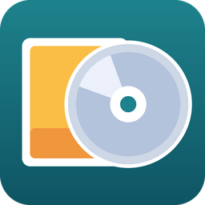
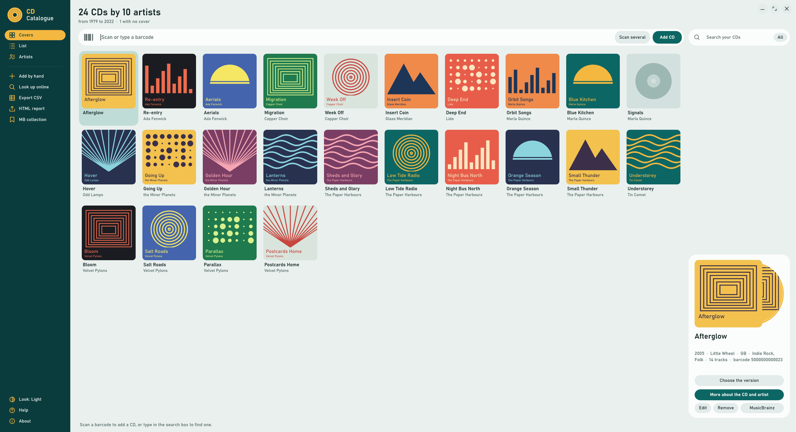
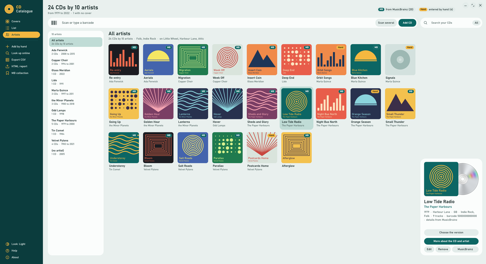
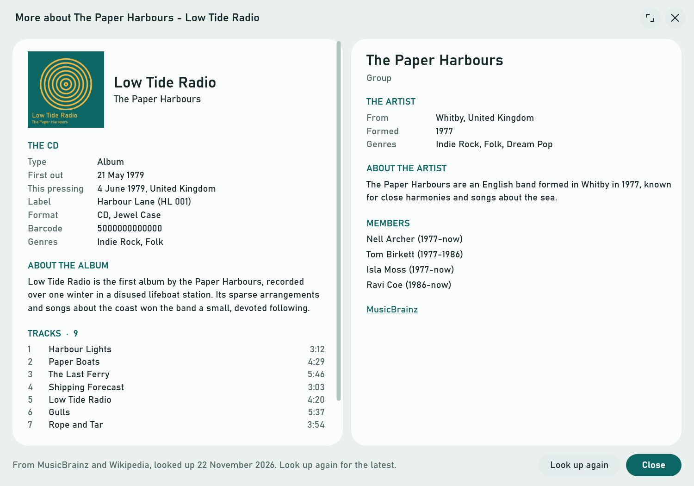
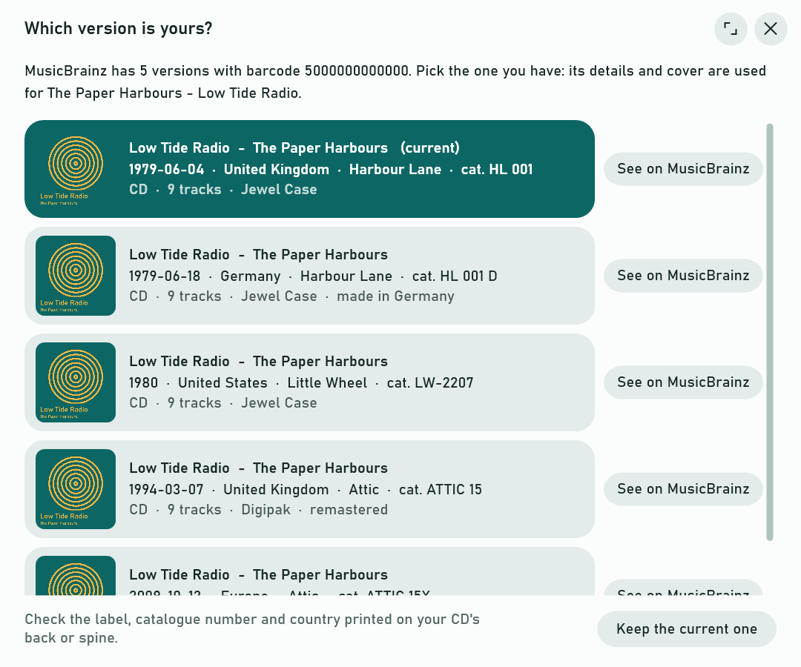

  

# CD Catalogue

A searchable list of your CDs, with artist, album, year and cover.

    

## ✨ Features

CD Catalogue is a PowerShell/WPF tool that keeps a searchable list of your physical CDs: artist, album, year, label, tracks and discs, barcode, cover and your own notes.

- **Add a CD by its barcode**: scan the barcode on the back with a USB or Bluetooth barcode scanner (it types the number and presses Enter), or type the number. The details come from [MusicBrainz](https://musicbrainz.org) and the cover from the [Cover Art Archive](https://coverartarchive.org), both free with no account.
- **Scan one after another**: each barcode is looked up in turn in the background (MusicBrainz allows about one a second, so the app waits and retries when it's busy). A CD already in the list is pointed out instead of being added twice, and a barcode MusicBrainz doesn't know is kept as "(not found)" for you to fill in.
- **Scan several, then Search**: press **Scan several**, scan a pile of CDs one after another (each barcode goes on a waiting list, and duplicates are pointed out as you scan), then press **Search** (or Enter in the empty box, or type `search`). They're then looked up one by one. **Cancel** or Esc forgets the list.
- **Which version is yours?**: MusicBrainz often has several versions of a CD with one barcode (other countries, reissues, labels, box sets). When it does, the app asks which you have once the look-ups finish, showing each one's cover, date, country, label, catalogue number, format and tracks. **Choose the version** shows them again at any time.
- **MusicBrainz account (optional)**: look-ups never need one. With one, **Add to MusicBrainz** opens MusicBrainz's Add release page with a not-found CD's barcode filled in, and **MB collection** sends your CDs to a collection in your account (sign in once with an application you register in your MusicBrainz account; the sign-in is kept encrypted for your Windows account, and your password is never seen by the app).
- **CDs with no barcode**: Add by hand, with Look up by artist and album.
- **Artists, like a discography**: the **Artists** view lists every artist with how many CDs you have and the years they span, starting on **All artists** (every CD in artist order); pick one to see all their albums together, oldest first, with their genres and labels.
- **MB or Hand**: a mark on every cover and list row shows whether the CD's details came from MusicBrainz (**MB**) or were entered by hand (**Hand**). The key at the top shows how many of each; click one to show only those CDs. The CSV and HTML report say so too.
- **Search by field**: search everything, or pick one thing with the button in the search box (artist, album, year, label, genre, barcode or notes). You can also type them and mix them, such as `year:1990-1999 label:"little wheel"`. A year can be one year, a range (1990-1999) or a decade (1990s).
- **The CD's label**: the disc beside the cover shows a photo of the CD itself when the Cover Art Archive has one.
- **A wall of covers**: your collection as album art, or as a sortable list, in the app's own teal and amber look with its own window frame.
- **More about the CD and artist**: the CD's track listing with times, when the album first came out, the pressing's label and catalogue number, format, genres and the album's Wikipedia introduction; beside it the artist: where they're from, when they formed or were born, genres, the band's members with their years, the Wikipedia introduction, and links to MusicBrainz, Wikipedia, Discogs and their own site. It's kept, so it opens at once next time.
- **Backup and restore**: the whole catalogue (CDs, notes, covers and disc photos) in one .zip file, and back again on this PC or another. A restore saves what was there first, so it can be undone.
- **Pick for me**: can't decide? A CD at random from the ones shown.
- **Search by song**: find which CD has a song (track lists come from MusicBrainz in the background).
- **What's missing?**: an artist's studio albums on MusicBrainz, with the ones you have marked.
- **Stats**: your collection in numbers, with bars for each decade, the artists you have most of, top labels and genres.
- **Kept**: note where each CD lives, picked from your own list of places (such as In Front Room and In Loft), and search for it.
- **Export CSV**: saves the list (or what your search found) as a CSV file for Excel and other spreadsheets, as listed, by artist or by place.
- **HTML report**: saves it as a page with the covers, to open in any browser, print or share, as listed, by artist or by place (a list to print and keep with them). Hover over a cover to see it bigger, or over an album for its details and tracks.
- **Excel-safe CSV**: opens correctly with a double-click, with every barcode digit and titles such as 007 or 3/4 as typed. Such values are written as `="007"` in the file, which programs other than spreadsheets will show as they are.
- Sort by any column in the list; the selected CD's sleeve, disc and details beside it; Edit, Remove, open the CD's MusicBrainz page, light and dark looks, Help and an About box.

## 🖼️ Screenshots

## 📋 Requirements

- Windows 10 or 11.
- Windows PowerShell 5.1 (built into Windows) with .NET Framework 4.7.2 or later.
- An internet connection for the look-ups, and (optional) a USB or Bluetooth barcode scanner. Any scanner that works as a keyboard will do; without one, type the number under the bars.

## 📦 Installation

1. Download `CD-Catalogue-v1.04.zip` from the [latest release](../../releases/latest) and unzip it wherever you like to keep it.
2. Double-click **CD Catalogue.cmd** in the unzipped folder. It makes a **CD Catalogue** shortcut there and in the Start menu, and starts the tool. From then on, use the shortcut, the Start menu or a pinned taskbar button.

Nothing is installed and no Windows settings are changed. The shortcut runs the script with PowerShell's execution policy bypassed for that run only.

**From the repo:** clone it and double-click **Start CD Catalogue.cmd**.

### Why no exe

Home tools used to ship as PS2EXE exes, and antivirus programs (ESET among them) kept flagging those exes as generic trojans by mistake. A plain script and a shortcut give the same one-click start without the false alarms, and you can read exactly what runs.

### Build a release

Double-click **Build.cmd** in the repo folder. It reads `build.json`, checks every script for syntax errors and that `$script:AppVersion` matches the newest `CHANGELOG.md` entry (if the version lives in a file of its own, add `"VersionFile": "src\\<file>.ps1"` to `build.json`; that file can call it `$script:<Name>Version`), runs PSScriptAnalyzer if it's installed, copies the release files into `..\Builds\CD Catalogue v<version>\`, zips that folder for the GitHub release, refreshes `..\Builds\CD Catalogue.lnk` (what the Home Launcher starts) and scans the result with ESET's command-line scanner if it's installed.

## 🚀 Usage

1. Start CD Catalogue (the shortcut, the Start menu, or **CD Catalogue.cmd**). The barcode box is ready.
2. Scan the barcode on the back of a CD (or type the number and press **Enter**). Carry on with the next CD; each appears in the list with its cover as soon as it's found.
3. To scan a pile first: press **Scan several**, scan each CD, then press **Search** to look them all up one after another.
4. If MusicBrainz has several versions of a CD, pick yours when asked (or later with **Choose the version**).
5. Press **Artists** to see each artist's CDs together, oldest first.
6. Type in the search box to find a CD. To search just one thing, pick it with the **All** button in the box, or type it: `artist:`, `album:`, `year:`, `label:`, `genre:`, `barcode:` or `notes:`.
7. Press **More about the CD and artist** for its tracks and the artist.

## ⚙️ Configuration

**Where settings live:** `%APPDATA%\CD Catalogue`, never inside the repo or a release folder.

- `catalogue.json`: the CDs.
- `Covers\`: the covers and disc photos from the Cover Art Archive.
- `Info\`: what More about the CD and artist found, so it opens at once next time.
- `Tracks\`: each CD's track titles, for searching by song.
- `Backups\`: your catalogue as it was before a restore.
- `settings.json`: the look, covers, list or artists, your places for Kept, and (if you use MB collection) the MusicBrainz sign-in, encrypted for your Windows account.
- `CD Catalogue.log`: look-ups and anything that went wrong.

## 📝 Changelog

See [CHANGELOG.md](CHANGELOG.md).

## 📄 Licence

[MIT](LICENSE). Copyright (c) 2026 Jason Rhodes.

Created by Jason Rhodes, built with Claude (Anthropic).
